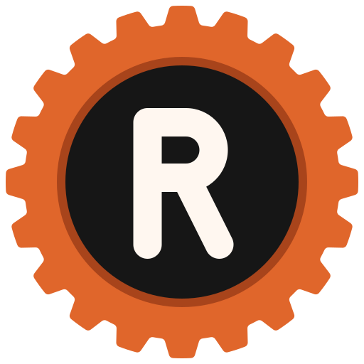

# Rustine

A set of libraries and tools that help you mix Rust and Kotlin
using [UniFFI](https://github.com/mozilla/uniffi-rs). Rustine is a hard fork
of [Gobley](https://github.com/gobley/gobley), which was itself forked
from [UniFFI Kotlin Multiplatform bindings](https://gitlab.com/trixnity/uniffi-kotlin-multiplatform-bindings).

Currently, Android, Kotlin/JVM, and Kotlin/Native are supported. WASM is not supported yet.

## Features

- UniFFI Bindings Generation for Kotlin Multiplatform (Android, JVM, Kotlin/Native)
- KotlinX Serialization Support
- Automatic building and linking of Rust libraries to Kotlin projects

## Requirements

- JDK 17 or higher.
- Gradle 8.11 or higher.
- For Android, the Android Gradle Plugin (AGP) 9.1 or higher, which requires Gradle 9.3.1 or
  higher. Android modules must be either `com.android.application`/`com.android.library` modules
  using the built-in Kotlin support of AGP, or Kotlin Multiplatform modules using
  `com.android.kotlin.multiplatform.library`. Kotlin 2.4.0 or higher is recommended. Projects still
  using AGP 8 should use [Gobley](https://github.com/gobley/gobley) 0.3.7 or older.

## Getting started

Please read the [tutorial](https://lidory-dev.github.io/rustine/docs/tutorial) and
the [documentation](https://lidory-dev.github.io/rustine/docs) to get started. If you have trouble setting up your
project, please create a question
in [GitHub Discussions](https://github.com/lidory-dev/rustine/discussions). For the contribution guide,
please refer to [here](./CONTRIBUTING.md).
